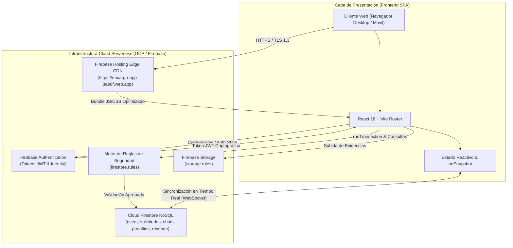
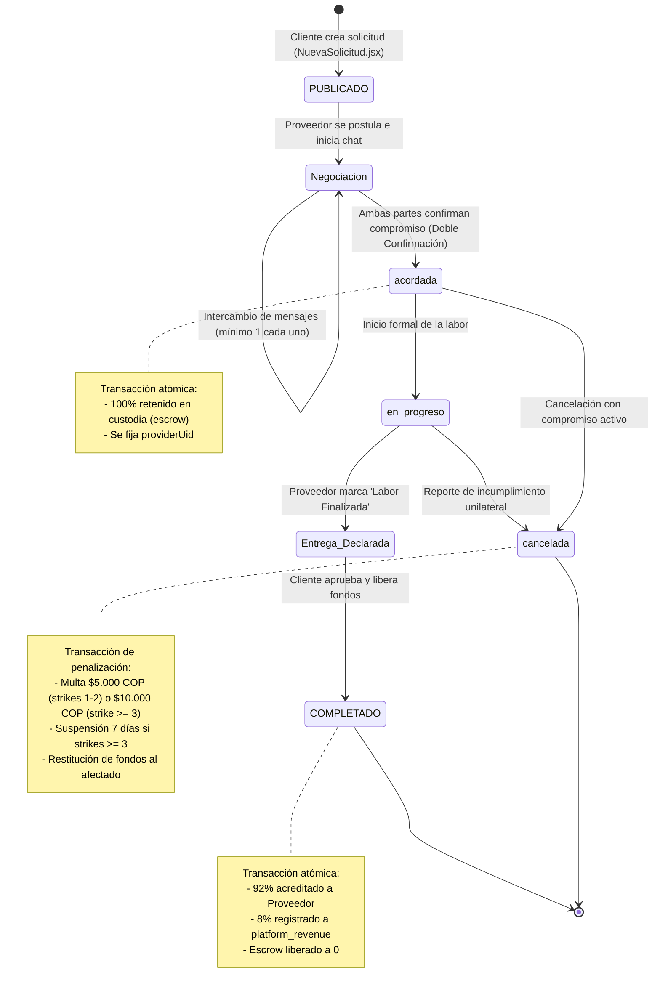
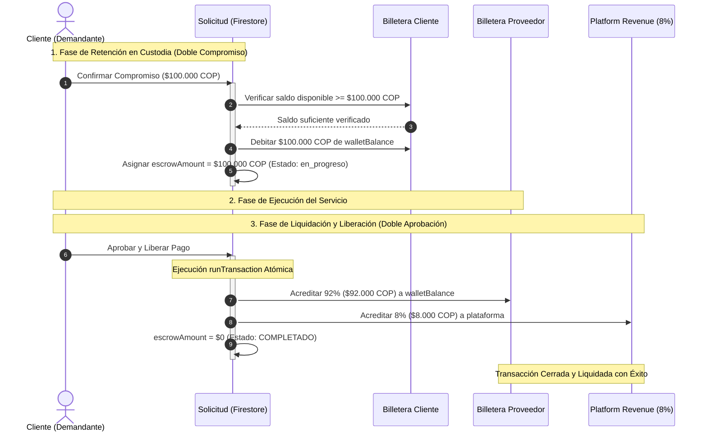
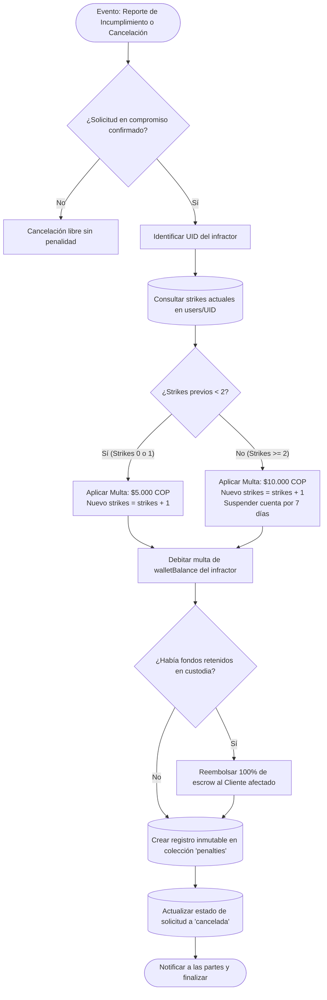

# Módulo 5: Diagramas de Arquitectura y Procesos
**Plataforma de Intermediación de Servicios «Encargo»**
*Representación Gráfica Formal de Flujos de Negocio, Estados y Topología*

---

## 5.1 Diagrama 1: Arquitectura Global del Sistema

Este diagrama ilustra la separación de capas entre el cliente web (SPA React), la red de distribución de contenidos (Firebase Hosting CDN), los servicios de identidad (Firebase Auth) y la capa de base de datos distribuida con motor de reglas (Cloud Firestore).

---

## 5.2 Diagrama 2: Máquina de Estados del Ciclo de Vida de una Solicitud

Representa las transiciones formales por las que atraviesa un encargo desde su publicación inicial hasta su liquidación o cancelación.

---

## 5.3 Diagrama 3: Flujo Transaccional de Custodia (Escrow) y Distribución 92% / 8%

Modela el intercambio financiero atómico bajo la primitiva `runTransaction` de Firestore para garantizar que no existan inconsistencias monetarias.

---

## 5.4 Diagrama 4: Protocolo de Penalizaciones, Multas COP y Suspensión de 7 Días

Detalla la lógica algorítmica aplicada ante cancelaciones unilaterales o incumplimientos auditados.

